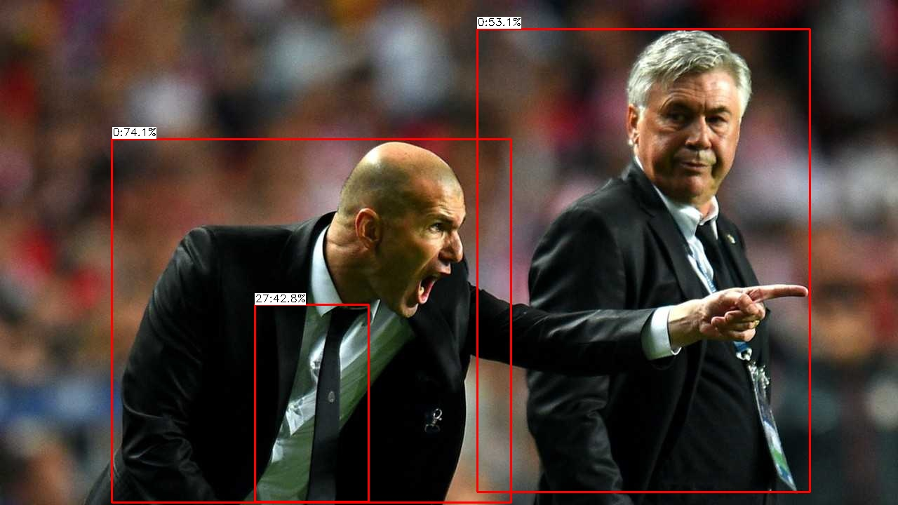
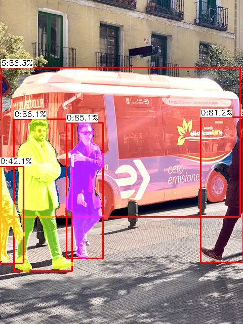
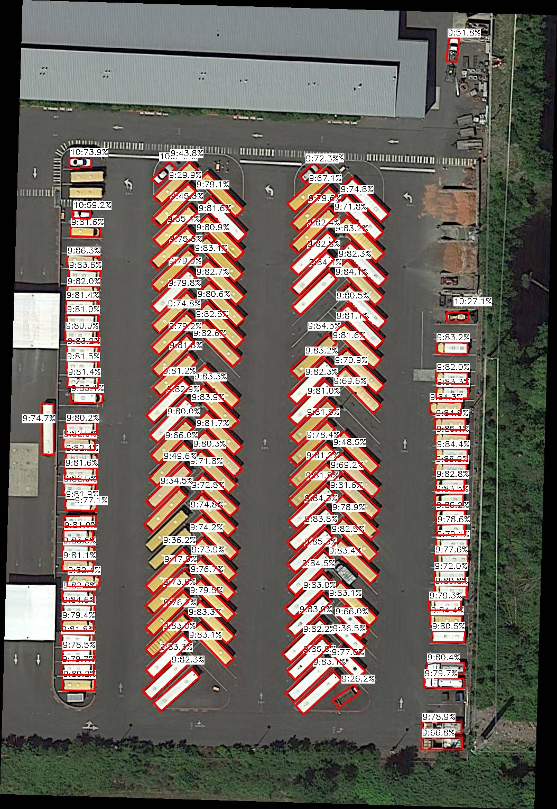
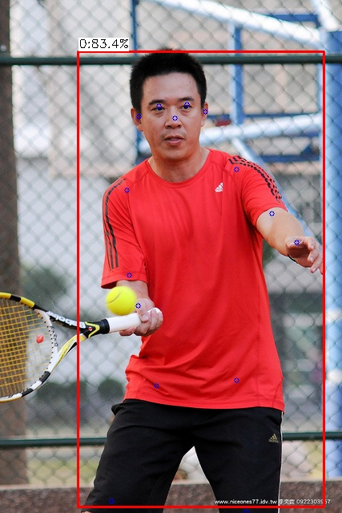

# YoloSharp（简体中文）

**纯 C# + TorchSharp 训练与运行 YOLO 模型。**
无需 Python——从训练到推理，全部在 .NET 内完成。

[English](README.md)

## ✨ 功能特性

- **100% C# 实现** – 无需 Python 环境，无额外依赖。
- **全流程支持** – 使用自定义模型训练、验证、推理。
- **多 YOLO 版本** – 支持 YOLOv5、YOLOv5u、YOLOv8、**YOLOv9（GELAN，检测+分割）**、YOLOv11、YOLOv12。
- **全任务类型** – 目标检测、实例分割、旋转框（OBB）、姿态估计（关键点）、分类。
- **多种模型规格** – 每种架构均有 n/s/m/l/x 版本。
- **高级预处理** – 内置 LetterBox 与 Mosaic4 数据增强。
- **ONNX 导出** – 训练模型（全部任务）一键导出可部署 ONNX（支持动态 batch）；已在 ONNX Runtime / OpenVINO / TensorRT 上验证。
- **GPU 加速 NMS** – 非极大值抑制直接在 GPU 上运行。
- **预训练模型** – 加载 Ultralytics YOLO（v5/v8/v11）及转换的 YOLOv12 权重。
- **跨平台** – .NET 6+，另支持 netstandard2.0 / .NET Framework 4.8。

## 🤔 为什么选 YoloSharp？

- **无需 Python 环境** – 告别 Conda、pip、依赖地狱与版本冲突，一切运行在你现有的 .NET 生态内。
- **无缝集成** – 直接使用 C# 数据结构、LibTorch 绑定（TorchSharp）、OpenCV 绑定（OpenCvSharp）以及你的 .NET 日志/链路追踪设施。
- **简化部署** – 把训练好的模型与推理逻辑打包进单个 .NET 应用或容器，无需独立 Python 微服务。
- **性能** – 通过 LibTorch/TorchSharp 利用 GPU 加速，完全掌控内存与执行。
- **生产力** – 训练、验证与其余后端/桌面/游戏逻辑同语言，一种语言一套工具链。
- **高性价比** – 生产环境去掉 Python 运行时，降低运维开销。

无论桌面应用、云服务还是边缘设备方案，YoloSharp 都能让你的技术栈保持一致且易维护。

## 🔥 近期更新

**2026/11/11**
🚀 **YOLOv9（GELAN）**支持：检测（yolov9-s，与官方权重 1:1 对齐、1774 张量）与分割（gelan-c-seg），已回馈开源。
🚀 **ONNX 导出引擎**：检测/分割/姿态/OBB 头 + v5/v8/v9/v11/v12 骨干；动态 batch 输入；导出 EMA 权重；BN 融合；opset 13。
🚀 **部署链路**：导出的 ONNX 已在 ONNX Runtime、OpenVINO（动态 batch）与 TensorRT（静态/动态 profile）上验证。

**2026/10** —— 训练对齐 ultralytics：EMA（decay 0.9999、tau 2000）、warmup 三件套（bias-lr/momentum/累积）、梯度裁剪 10.0、确定性随机种子、召回守门（best 选择）、batch 级停止、逐轮 results.png 重绘。

🚀 支持加载 .pt 权重。
🚀 新增 **netstandard2.0** 支持。
🚀 训练与推理均支持 **端到端（End2End）**。
🚀 warm-up 调度，训练起步更稳。
🚀 验证集矩形缩放变换（保持宽高比）。
🚀 训练中可关闭 mosaic 增强。
🚀 检测头偏置初始化，改善收敛。
🚀 用 `LambdaLR` 替换 `CosineAnnealingLR`，学习率调度更灵活。
🐛 修复 OBB 角度损失计算。
🐛 修复 HSV 变换实现。

## 📦 下载预训练模型

在下方获取官方 YOLO 检查点。

### 预测检查点

| 模型 | n | s | m | l | x |
| --- | --- | --- | --- | --- | --- |
| yolov5 | [yolov5n](https://github.com/IntptrMax/YoloSharp/releases/download/1.0.6/Yolov5n.bin) | [yolov5s](https://github.com/IntptrMax/YoloSharp/releases/download/1.0.6/Yolov5s.bin) | [yolov5m](https://github.com/IntptrMax/YoloSharp/releases/download/1.0.6/Yolov5m.bin) | [yolov5l](https://github.com/IntptrMax/YoloSharp/releases/download/1.0.6/Yolov5l.bin) | [yolov5x](https://github.com/IntptrMax/YoloSharp/releases/download/1.0.6/Yolov5x.bin) |
| yolov5u | [yolov5nu](https://github.com/IntptrMax/YoloSharp/releases/download/1.0.6/Yolov5nu.bin) | [yolov5su](https://github.com/IntptrMax/YoloSharp/releases/download/1.0.6/Yolov5su.bin) | [yolov5mu](https://github.com/IntptrMax/YoloSharp/releases/download/1.0.6/Yolov5mu.bin) | [yolov5lu](https://github.com/IntptrMax/YoloSharp/releases/download/1.0.6/Yolov5lu.bin) | [yolov5xu](https://github.com/IntptrMax/YoloSharp/releases/download/1.0.6/Yolov5xu.bin) |
| yolov8 | [yolov8n](https://github.com/IntptrMax/YoloSharp/releases/download/1.0.6/Yolov8n.bin) | [yolov8s](https://github.com/IntptrMax/YoloSharp/releases/download/1.0.6/Yolov8s.bin) | [yolov8m](https://github.com/IntptrMax/YoloSharp/releases/download/1.0.6/Yolov8m.bin) | [yolov8l](https://github.com/IntptrMax/YoloSharp/releases/download/1.0.6/Yolov8l.bin) | [yolov8x](https://github.com/IntptrMax/YoloSharp/releases/download/1.0.6/Yolov8x.bin) |
| yolov11 | [yolov11n](https://github.com/IntptrMax/YoloSharp/releases/download/1.0.6/Yolov11n.bin) | [yolov11s](https://github.com/IntptrMax/YoloSharp/releases/download/1.0.6/Yolov11s.bin) | [yolov11m](https://github.com/IntptrMax/YoloSharp/releases/download/1.0.6/yolov11m.bin) | [yolov11l](https://github.com/IntptrMax/YoloSharp/releases/download/1.0.6/Yolov11l.bin) | [yolov11x](https://github.com/IntptrMax/YoloSharp/releases/download/1.0.6/Yolov11x.bin) |

### 分割检查点

| 模型 | n | s | m | l | x |
| --- | --- | --- | --- | --- | --- |
| yolov8 | [yolov8n-seg](https://github.com/IntptrMax/YoloSharp/releases/download/1.0.6/Yolov8n-seg.bin) | [yolov8s-seg](https://github.com/IntptrMax/YoloSharp/releases/download/1.0.6/Yolov8s-seg.bin) | [yolov8m-seg](https://github.com/IntptrMax/YoloSharp/releases/download/1.0.6/Yolov8m-seg.bin) | [yolov8l-seg](https://github.com/IntptrMax/YoloSharp/releases/download/1.0.6/Yolov8l-seg.bin) | [yolov8x-seg](https://github.com/IntptrMax/YoloSharp/releases/download/1.0.6/Yolov8x-seg.bin) |
| yolov11 | [yolov11n-seg](https://github.com/IntptrMax/YoloSharp/releases/download/1.0.6/Yolov11n-seg.bin) | [yolov11s-seg](https://github.com/IntptrMax/YoloSharp/releases/download/1.0.6/Yolov11s-seg.bin) | [yolov11m-seg](https://github.com/IntptrMax/YoloSharp/releases/download/1.0.6/Yolov11m-seg.bin) | [yolov11l-seg](https://github.com/IntptrMax/YoloSharp/releases/download/1.0.6/Yolov11l-seg.bin) | [yolov11x-seg](https://github.com/IntptrMax/YoloSharp/releases/download/1.0.6/Yolov11x-seg.bin) |

## 🚀 快速上手

### 从 NuGet 安装

```bash
dotnet add package IntptrMax.YoloSharp
```

> [!注]
> 还需添加 LibTorch 包（版本 2.5.1.0）之一以及 `OpenCvSharp4.runtime`：
> - `libtorch-cpu`
> - `libtorch-cuda-12.1`
> - `libtorch-cuda-12.1-win-x64`
> - `libtorch-cuda-12.1-linux-x64`

### 基本用法

```csharp
string preTrainedModelPath = @"..\..\..\Assets\PreTrainedModels\yolov8n-obb.bin"; // 预训练模型路径。
string predictImagePath = @"..\..\..\Assets\TestImage\trucks.jpg";
string dataRootPath = @"..\..\..\Assets\datasets\dotav1";

string trainDataPath = @"train.txt";
string valDataPath = @"val.txt";

Mat predictImage = Cv2.ImRead(predictImagePath);

// 创建 Yolo 配置
Config config = new Config
{
    DeviceType = DeviceType.CUDA,
    ScalarType = ScalarType.BFloat16,
    RootPath = dataRootPath,
    TrainDataPath = trainDataPath,
    ValDataPath = valDataPath,
    YoloType = YoloType.Yolov8,
    YoloSize = YoloSize.n,
    TaskType = TaskType.Obb,
    ImageProcessType = ImageProcessType.Mosiac,
    ImageSize = 640,
    BatchSize = 16,
    NumberClass = 15,
    PredictThreshold = 0.3f,
    IouThreshold = 0.7f,
    Workers = 4,
    Epochs = 100,
    LearningRate = 1e-4f,
    Patience = 50,
    KeyPoint_Num = 21,
    KeyPoint_Dim = 3,
};

// 创建 yolo 任务。
YoloTask yoloTask = new YoloTask(config);

// 加载预训练模型。若不使用预训练模型，可跳过此步。
yoloTask.LoadModel(preTrainedModelPath, skipNcNotEqualLayers: true);

// 训练模型
yoloTask.Train();

// 图像推理（模型未训练/未加载时将使用随机权重）。
List<YoloResult> predictResult = yoloTask.ImagePredict(predictImage);
```

## 📸 效果示例

| 模型 | 输出 |
|-------|--------|
| YOLOv8n（检测） |  |
| YOLOv8n‑seg |  |
| YOLOv8n‑obb |  |
| YOLOv8n‑pose |  |

---

**在 .NET 里完整享受 YOLO——无需 Python！**
欢迎贡献与反馈！
